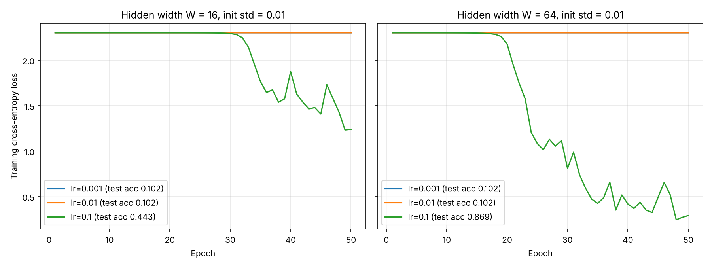
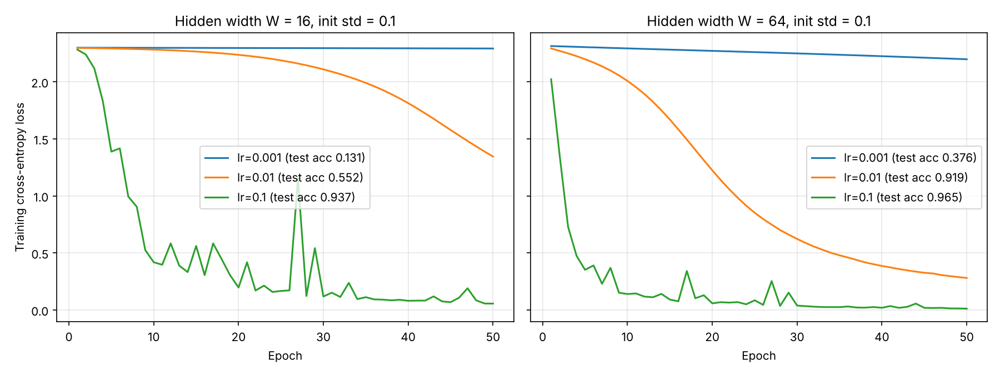

# Lab 02: A neural network from scratch

Two-hidden-layer fully connected network for the sklearn `load_digits` dataset, written in plain NumPy: forward pass, cross-entropy loss, hand-derived backpropagation, numerical gradient check, mini-batch SGD training and forward/backward timing.

## How to run

```
cd lab02
python src/check_forward.py
python src/grad_check.py
python src/train.py
python src/timing.py
```

| File | Task |
|---|---|
| `src/data.py` | 1. Load, scale by 1/16, one-hot, stratified 70/30 split (`random_state=42`) |
| `src/nn.py` | 2–5. Parameters, forward pass, cross-entropy, backward pass |
| `src/check_forward.py` | 3–4. Output shape, softmax row sums, untrained loss |
| `src/grad_check.py` | 5. Numerical gradient check |
| `src/train.py` | 6. Training loop, loss curves, test accuracy |
| `src/timing.py` | 7. Forward vs backward timing |

All outputs are saved in `results/`.

## 1. Dataset

- 1797 images of 8×8 digits → 64 features, values 0–16 scaled to [0, 1].
- Labels one-hot encoded to 10 classes.
- Stratified split: 1257 train, 540 test.

## 2. Network design

```
X (B, 64) ──W1 (64,W), b1 (W,)──► z1 (B,W) ──ReLU──► a1 (B,W)
          ──W2 (W,W),  b2 (W,)──► z2 (B,W) ──ReLU──► a2 (B,W)
          ──W3 (W,10), b3 (10,)─► z3 (B,10) ──softmax──► p (B,10)
```

| Parameter | Shape | W = 16 | W = 64 |
|---|---|---|---|
| W1 | (64, W) | 1024 | 4096 |
| b1 | (W,) | 16 | 64 |
| W2 | (W, W) | 256 | 4096 |
| b2 | (W,) | 16 | 64 |
| W3 | (W, 10) | 160 | 640 |
| b3 | (10,) | 10 | 10 |
| **Total** | | **1482** | **8970** |

Weights are drawn from N(0, 0.01) with standard deviation 0.01; biases are zero.

## 3. Forward pass

```
z1 = X W1 + b1,   a1 = ReLU(z1)
z2 = a1 W2 + b2,  a2 = ReLU(z2)
z3 = a2 W3 + b3,  p  = softmax(z3)
```

Softmax subtracts the row maximum before `exp` for numerical stability.
Check (`results/forward_check.txt`): output shape is `(32, 10)` and every row sums to 1 within 1e-6, for both widths.

## 4. Cross-entropy loss

L = −(1/B) Σᵢ Σₖ yᵢₖ log pᵢₖ

With weights ~ N(0, 0.01), the logits are almost zero, so softmax gives ≈ 0.1 for each class and L ≈ −log(0.1) = ln 10.
Measured untrained loss: **2.3026** for both widths (ln 10 = 2.3026).

## 5. Backpropagation

Chain rule, from the output to the input (B = batch size, ⊙ = elementwise product):

1. Softmax + cross-entropy: ∂L/∂z3 = δ3 = (p − y) / B
2. Output layer: ∂L/∂W3 = a2ᵀ δ3, ∂L/∂b3 = Σ_rows δ3
3. Back through W3 and ReLU: δ2 = (δ3 W3ᵀ) ⊙ 1[z2 > 0]
4. ∂L/∂W2 = a1ᵀ δ2, ∂L/∂b2 = Σ_rows δ2
5. δ1 = (δ2 W2ᵀ) ⊙ 1[z1 > 0]
6. ∂L/∂W1 = Xᵀ δ1, ∂L/∂b1 = Σ_rows δ1

Step 1 comes from ∂L/∂zₖ = Σⱼ (∂L/∂pⱼ)(∂pⱼ/∂zₖ) = Σⱼ (−yⱼ/pⱼ) pⱼ(1[j=k] − pₖ) = pₖ Σⱼ yⱼ − yₖ = pₖ − yₖ, because Σⱼ yⱼ = 1.

### Gradient check

10 random weights (from W1, W2, W3) are nudged by ±1e-5, and the numerical slope (L(w+ε) − L(w−ε)) / 2ε is compared to the analytic gradient with
relative error = |analytic − numeric| / max(|analytic|, |numeric|).

**Result: 10/10 weights pass (< 1e-6) for both W = 16 and W = 64** (`results/grad_check.txt`). Typical errors are 1e-8 to 1e-7.

Implementation note: with N(0, 0.01) weights the gradients are very small (1e-5 to 1e-8). When the loss is averaged first, L(w+ε) − L(w−ε) loses digits to float64 rounding and the relative error rises to about 1e-5, even though the analytic gradient is correct. The numerical slope is therefore computed as the mean of per-sample loss differences, mean(lᵢ(w+ε) − lᵢ(w−ε)) / 2ε, which is mathematically the same slope but much less affected by rounding. Weights with gradient exactly 0 (for example W1 rows for pixels that are always 0, or dead ReLUs) give 0 for both methods.

## 6. Training

Mini-batch SGD, batch size 32, data shuffled every epoch, 50 epochs; the training loss over the full train set is logged after every epoch (`results/train_log.txt`).



Final test accuracy with weights ~ N(0, 0.01), as required (`results/accuracy.md`):

| Width | Learning rate | Final train loss | Test accuracy |
|---|---|---|---|
| 16 | 0.001 | 2.3025 | 0.1019 |
| 16 | 0.01 | 2.3025 | 0.1019 |
| 16 | 0.1 | 1.2406 | 0.4426 |
| 64 | 0.001 | 2.3025 | 0.1019 |
| 64 | 0.01 | 2.3023 | 0.1019 |
| 64 | 0.1 | 0.2921 | 0.8685 |

The lr = 0.001 line is hidden under the lr = 0.01 line because both stay at ≈ 2.30.

**Observations**

- With std 0.01, the signal shrinks by roughly a factor of 0.01·√(fan-in) (0.08 or less) at every layer, so the gradients for W1 and W2 are tiny. With lr = 0.001 and 0.01 the network barely moves away from the uniform prediction during 50 epochs (accuracy ≈ 10%, i.e. chance level).
- With lr = 0.1 there is a long plateau, after which the loss drops sharply once the weights grow enough to break symmetry. The wider network (W = 64) escapes the plateau earlier (≈ epoch 20 vs ≈ 31) and reaches 86.9% test accuracy against 44.3% for W = 16.
- The curves at lr = 0.1 are noisy because the step is large relative to the batch-size-32 gradient noise.

### Extra: initialisation std 0.1

N(0, 0.01) can also be read as variance 0.01 (std 0.1). For comparison, the same experiment with std 0.1 (`results/loss_curves_std0.1.png`, `results/accuracy_std0.1.md`):

| Width | Learning rate | Final train loss | Test accuracy |
|---|---|---|---|
| 16 | 0.001 | 2.2918 | 0.1315 |
| 16 | 0.01 | 1.3446 | 0.5519 |
| 16 | 0.1 | 0.0558 | 0.9370 |
| 64 | 0.001 | 2.1974 | 0.3759 |
| 64 | 0.01 | 0.2805 | 0.9185 |
| 64 | 0.1 | 0.0117 | 0.9648 |



A larger initialisation removes the plateau, and all learning rates make progress. The best result is W = 64, lr = 0.1 with 96.5% test accuracy. In both settings, a larger learning rate and a wider network train faster within 50 epochs.


## 7. Timing

Median of 100 runs after 10 warm-up runs, `time.perf_counter` (`results/timing.md`). "Forward" and "Backward" time the full passes from `nn.py`. The "matmul" columns time only the matrix multiplications of each pass. GFLOP counts only matrix multiplications (2·m·n·k per product).

| Width | Batch | Forward (ms) | Backward (ms) | Bwd/Fwd | Fwd matmul (ms) | Bwd matmul (ms) | Fwd GFLOP | Bwd GFLOP |
|---|---|---|---|---|---|---|---|---|
| 16 | 32 | 0.0304 | 0.0331 | 1.09 | 0.0050 | 0.0086 | 0.0001 | 0.0001 |
| 16 | 1257 | 0.3636 | 0.4155 | 1.14 | 0.0787 | 0.1559 | 0.0036 | 0.0047 |
| 16 | 8192 | 4.1341 | 3.2198 | 0.78 | 0.4370 | 1.3149 | 0.0236 | 0.0304 |
| 64 | 32 | 0.0484 | 0.0600 | 1.24 | 0.0175 | 0.0306 | 0.0006 | 0.0009 |
| 64 | 1257 | 0.8902 | 1.3055 | 1.47 | 0.3615 | 0.7074 | 0.0222 | 0.0341 |
| 64 | 8192 | 8.5551 | 8.0615 | 0.94 | 1.7814 | 4.0229 | 0.1447 | 0.2223 |

Measured on a 2-core cloud VM, CPU only; absolute numbers depend on the machine, and the full-pass times vary between runs by up to about 30%.

### Which pass dominates and why

**Matrix multiplication: the backward pass dominates, about 2× the forward pass, in every configuration.** The reason is the number of products:

- **Forward** has 3 matmuls, one per layer: X W1, a1 W2, a2 W3.
- **Backward** has 5 matmuls: for each layer, one for the weight gradient (a2ᵀδ3, a1ᵀδ2, Xᵀδ1) and one to send the error back to the previous layer (δ3 W3ᵀ, δ2 W2ᵀ). The first layer has no previous layer, so δ1 W1ᵀ is skipped; with it the count would be 6, i.e. exactly 2× forward.

In FLOPs the backward pass does about 1.3× (W = 16) to 1.5× (W = 64) more matmul work. The measured matmul time ratio is higher (about 2×) because the weight-gradient products such as Xᵀδ1 reduce along the long batch dimension with transposed operands, which uses the cache less efficiently than the forward products.

**Full passes: the gap is smaller and depends on the size.** For W = 64 and batch 32 or 1257, the backward pass is still clearly slower (1.24× and 1.47×). In the other cases the two passes take about the same time, because at this network size most of the time is not spent in matrix multiplication:

- Matmuls are only about 10–40% of the full forward time. The rest is elementwise, memory-bound work: adding biases, ReLU, and the softmax (`max`, `exp`, sum, division over the whole batch). The forward pass also allocates the cached arrays z1, a1, z2, a2.
- With only 64 inputs and 16–64 hidden units, the matmuls are so small that they do not keep the CPU busy, so their extra FLOPs in the backward pass are partly hidden by the elementwise work and Python call overhead.

As the hidden width grows, the W×W products grow quadratically while the elementwise work grows only linearly. Matrix multiplication then takes most of the time, and the backward pass approaches its 5/3 to 2× cost. This is why, in real (much wider) networks, a training step costs about 3× a forward pass: one forward plus a backward pass that is about twice as expensive, almost all of it in matrix multiplication.
