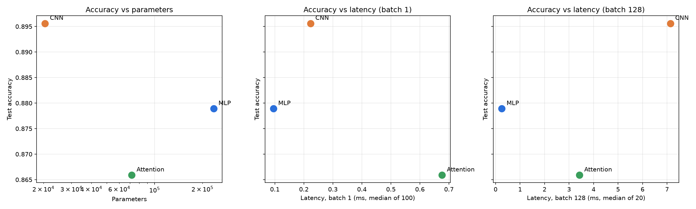
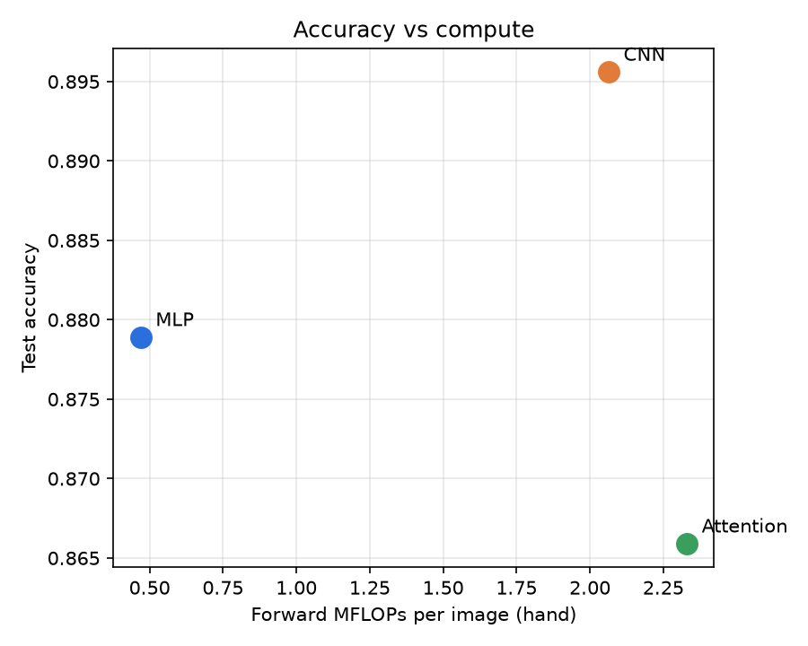

# Lab 03: Architectures and their costs

Three small classifiers for Fashion-MNIST (MLP, CNN, patch-based Transformer) implemented in PyTorch and compared on parameter count, forward FLOPs (by hand and with profilers), inference latency and test accuracy.

## How to run

```
cd lab03
python src/cost.py
python src/train.py
python src/plot.py
```

| File | Task |
|---|---|
| `src/data.py` | 1. Fashion-MNIST, `ToTensor` + `Normalize((0.2860,), (0.3530,))`, 55k / 5k / 10k split, batch 128 |
| `src/models.py` | 2. MLP, CNN, patch Transformer |
| `src/flops.py` | 3. Hand FLOP formulas from Ch. 4 |
| `src/cost.py` | 3. `torchinfo.summary`, `thop.profile`, PyTorch `FlopCounterMode`, latency |
| `src/train.py` | 4. Adam, lr 1e-3, batch 128, 5 epochs, validation and test accuracy |
| `src/plot.py` | 5. Accuracy vs parameters and vs latency |

All outputs are saved in `results/`.

## 1. Dataset

- `torchvision.datasets.FashionMNIST`, 28×28 grayscale, 10 classes.
- Transform: `ToTensor()` then `Normalize((0.2860,), (0.3530,))`.
- Official 60k train split into 55,000 train / 5,000 validation with `random_split` and a fixed generator (seed 42).
- Official 10k test set used only for the final accuracy.
- Batch size 128 for training and evaluation.

## 2. Models

```
MLP        (B,1,28,28) → Flatten 784 → Linear 256 → ReLU → Linear 128 → ReLU → Linear 10
CNN        (B,1,28,28) → Conv 1→16, 3×3, p=1 → ReLU → MaxPool 2 → (B,16,14,14)
                       → Conv 16→32, 3×3, p=1 → ReLU → MaxPool 2 → (B,32,7,7) → Flatten 1568 → Linear 10
Attention  (B,1,28,28) → 16 patches of 7×7 → (B,16,49) → Linear 49→64 + learned position embedding
                       → 2 × TransformerEncoderLayer(d_model=64, nhead=4, dim_feedforward=128)
                       → mean over 16 tokens → Linear 64→10
```

The Transformer uses a learned positional embedding (16 × 64 = 1,024 parameters). Without it, mean pooling makes the model invariant to patch order, so it cannot tell the top of a shoe from the bottom. Dropout is set to 0 so all three models are trained under the same conditions.

### Parameter counts

| Model | Layer-by-layer | Total |
|---|---|---|
| MLP | 200,960 + 32,896 + 1,290 | **235,146** |
| CNN | 160 + 4,640 + 15,690 | **20,490** |
| Attention | 3,136 + 64 (embed) + 1,024 (pos) + 2 × 33,472 (encoder) + 650 (head) | **71,818** |

One encoder layer: QKV `64×192+192 = 12,480`, output projection `4,160`, FFN `8,320 + 8,256`, two LayerNorms `256` → 33,472.

`torchinfo.summary` gives the same totals (see `results/torchinfo_summary.md`).

None of the specified architectures falls inside the 100k–150k target: the MLP is 1.6× above it, the CNN is 5× below it and the Transformer about 1.4× below. I kept the architectures exactly as specified, because the task fixes every layer size, and treat the parameter count as one of the axes being compared rather than as a controlled variable. The comparison is still informative: the three models span an 11× range of parameters and a 5× range of FLOPs.

## 3. Cost

### Hand-calculated FLOPs for one layer of each type

Formulas from Ch. 4, one multiply-add = 2 FLOPs, batch 1, forward pass, biases and activations ignored.

| Type | Layer | Formula | FLOPs |
|---|---|---|---|
| Linear | MLP Linear 784→256 | `2 × 784 × 256` | 401,408 |
| Conv2d | CNN Conv2d 16→32, 3×3, out 14×14 | `2 × 3 × 3 × 16 × 32 × 14 × 14` | 1,806,336 |
| Attention | QKV projections | `2 × 16 × 64 × 3 × 64` | 393,216 |
| Attention | Scores QK^T | `2 × 16² × 64` | 32,768 |
| Attention | Weighted sum AV | `2 × 16² × 64` | 32,768 |
| Attention | Output projection | `2 × 16 × 64 × 64` | 131,072 |
| Attention | Self-attention block total | sum of four rows above | 589,824 |
| Attention | FFN 64→128→64 | `2 × 16 × 64 × 128 × 2` | 524,288 |
| Attention | Encoder layer total | attention + FFN | 1,114,112 |

### Whole-model FLOPs (hand)

| Model | Breakdown | Total FLOPs / image |
|---|---|---|
| MLP | 401,408 + 65,536 + 2,560 | **469,504** |
| CNN | 225,792 + 1,806,336 + 31,360 | **2,063,488** |
| Attention | 100,352 (embed) + 2 × 1,114,112 + 1,280 (head) | **2,329,856** |

Per-layer tables are in `results/flops_breakdown.md`.

### Hand vs measured

| Model | Params (torchinfo) | Hand FLOPs | thop MACs | thop ×2 | thop ×2 / hand | PyTorch FlopCounter | FlopCounter / hand |
|---|---|---|---|---|---|---|---|
| MLP | 235,146 | 469,504 | 234,752 | 469,504 | 1.000 | 469,504 | 1.000 |
| CNN | 20,490 | 2,063,488 | 1,031,744 | 2,063,488 | 1.000 | 2,063,488 | 1.000 |
| Attention | 71,818 | 2,329,856 | 591,488 | 1,182,976 | 0.508 | 2,198,784 | 0.944 |

**Explaining the gap.**

1. **MACs vs FLOPs.** `thop.profile` returns multiply-accumulates, not FLOPs. One MAC is a multiply plus an add, so `thop × 2` is the number to compare with the hand count. After this correction the MLP and CNN match the hand values exactly (ratio 1.000), which also shows that this thop version ignores biases, ReLU and max-pooling, just like the Ch. 4 formulas.
2. **thop sees only half of the Transformer (0.508).** thop works by attaching hooks to known module types (`nn.Linear`, `nn.Conv2d`, …). Inside `nn.TransformerEncoderLayer` the QKV projection is a raw parameter (`in_proj_weight`), the output projection is called functionally through `F.multi_head_attention_forward`, and `QK^T` and `AV` are plain tensor operations, so none of them trigger a hook. The modules thop does see are the patch embedding (100,352), the two FFN `nn.Linear` layers in each block (2 × 524,288) and the head (1,280): 1,150,208 FLOPs. The remaining 32,768 most likely come from the four LayerNorms, which thop counts as element-wise work while the hand formula ignores them. The 1,146,880 FLOPs thop misses are almost exactly the QKV projections, output projections, scores and weighted sums of both layers (2 × 589,824 = 1,179,648).
3. **Operator-level counter (0.944).** `torch.utils.flop_counter.FlopCounterMode` counts at the ATen operator level, so it does see the QKV and output projections. It is short by exactly 131,072 FLOPs = 2 layers × (32,768 scores + 32,768 weighted sum). `nn.MultiheadAttention` computes those two matmuls inside the fused `scaled_dot_product_attention` kernel, and the CPU variant of this kernel has no FLOP formula registered in this PyTorch build (2.14.1+cpu), so it is counted as zero. Adding those 131,072 back gives 2,329,856, the hand value exactly.

The hand formulas are therefore correct for all three models; the gaps are tool limitations. Profilers that work at module level (thop) miss functional calls, and operator-level counters miss fused kernels they have no formula for. This is the main reason to always compute at least one layer by hand.

### Inference latency

Protocol: `model.eval()`, `torch.inference_mode()`, random input of the right shape, 10 warm-up runs, then the median of 100 runs for batch 1 and 20 runs for batch 128, timed with `time.perf_counter`. The interquartile range shows the spread. Machine: AMD64 Family 25 Model 68 (AMD Ryzen, CPU only), 8 threads, torch 2.14.1+cpu, Python 3.11.8.

| Model | Batch 1 median (ms) | Batch 1 IQR (ms) | Batch 128 median (ms) | Batch 128 IQR (ms) | Per-image @128 (ms) | Throughput @128 (img/s) |
|---|---|---|---|---|---|---|
| MLP | 0.0951 | 0.0943–0.0957 | 0.254 | 0.250–0.257 | 0.0020 | 504,632 |
| CNN | 0.2230 | 0.2203–0.2249 | 7.136 | 6.710–7.338 | 0.0558 | 17,936 |
| Attention | 0.6762 | 0.6685–0.6813 | 3.423 | 2.857–3.600 | 0.0267 | 37,390 |

Effective compute rate (hand FLOPs / latency):

| Model | Batch 1 (GFLOP/s) | Batch 128 (GFLOP/s) | Time ×, batch 1 → 128 |
|---|---|---|---|
| MLP | 4.9 | 236.9 | 2.7× |
| CNN | 9.3 | 37.0 | 32.0× |
| Attention | 3.4 | 87.1 | 5.1× |

## 4. Training

Adam, lr 1e-3, batch 128, 5 epochs, cross-entropy, same seed for all models. Validation accuracy is logged after each epoch (`results/train_log.txt`); test accuracy is measured once at the end. Training was done on the same CPU.

| Model | Val acc (epoch 5) | Test acc | Train time 5 epochs (s) |
|---|---|---|---|
| MLP | 0.8808 | 0.8789 | 73.6 |
| CNN | 0.8906 | **0.8956** | 103.3 |
| Attention | 0.8708 | 0.8659 | 101.4 |

All three models were still improving at epoch 5 (validation loss falling every epoch), so the numbers compare the architectures at a fixed short budget, not at convergence. The Transformer starts lowest (80.6% after epoch 1 vs 84.5% MLP and 86.3% CNN) and gains the most per epoch, which is typical for a model without a built-in spatial prior.

## 5. Trade-offs





| | MLP | CNN | Attention |
|---|---|---|---|
| Test accuracy | 87.89% | **89.56%** | 86.59% |
| Parameters | 235k | **20k** | 72k |
| FLOPs / image | **0.47 M** | 2.06 M | 2.33 M |
| Latency batch 1 | **0.095 ms** | 0.223 ms | 0.676 ms |
| Throughput batch 128 | **505k img/s** | 18k img/s | 37k img/s |

### Access patterns (Ch. 4.6–4.7)

| | MLP | CNN | Attention |
|---|---|---|---|
| FLOPs per weight | 2 | ~100 | ~32 |
| Activation floats per image (largest layer) | 256 | 12,544 (16×28×28) | 1,024 (16×64), plus 4 × 16² attention scores |
| Dominant pattern | dense matmul, each weight used once per image | small kernel slid over a large feature map | dense matmuls per token + all-to-all `seq²` interaction |
| Operators per forward | 5 | 8 | ~30 (projections, reshapes, softmax, 2 LayerNorms per block, residuals) |

**MLP: weight-bound at batch 1, compute-bound when batched.** Every weight is used for exactly one multiply-add per image. At batch 1 this is a matrix-vector product: 0.94 MB of weights are streamed for only 0.47 MFLOPs, and the rate is just 4.9 GFLOP/s. Batching turns it into a matrix-matrix product that reuses each loaded weight 128 times, so 128× more work costs only 2.7× more time and the rate jumps to 237 GFLOP/s. A single large GEMM is the access pattern CPUs are best at, and activations are tiny (256 floats).

**CNN: activation-bound.** Weights are tiny (82 KB) and heavily reused, so weight traffic is not the problem. The problem is the feature maps: the first conv writes 12,544 floats per image, which ReLU and max-pool then read and write again, and the convolutions with only 1 and 16 input channels map to thin, inefficient matrix products. With 128 images the intermediate maps are about 6 MB, more than fits in L2 cache, so memory traffic grows linearly with the batch. That is why 128× more work costs 32× more time and the effective rate stays at 37 GFLOP/s. FLOPs per weight are high; FLOPs per byte of activation moved are low.

**Attention: overhead-bound at batch 1.** The matrices are tiny (16 tokens × 64), so each of the ~30 operators does very little arithmetic, and at batch 1 the time is dominated by per-operator overhead (launch, reshape, softmax and LayerNorm reductions): 0.68 ms, the slowest of the three at only 3.4 GFLOP/s. Batching amortises that overhead (128× work for 5× time, 87 GFLOP/s), but softmax and LayerNorm stay memory-bound reductions and the `seq²` attention scores are computed at run time, so it never reaches the MLP's rate. The global receptive field gives no benefit on 28×28 images after 5 epochs: the model has to learn locality that the CNN gets for free.

FLOPs alone do not predict latency. The CNN and the Transformer have almost the same FLOPs (2.06 M vs 2.33 M), yet the CNN is 3× faster at batch 1 and 2× slower at batch 128. The MLP has 4.4× fewer FLOPs than the CNN but is 28× faster at batch 128. Access pattern and operator count matter more than raw FLOPs.

### Which architecture is most cost-effective

**On this CPU, the MLP is the most cost-effective model for inference.** It gives up 1.7 percentage points of accuracy against the CNN (87.9% vs 89.6%) and is 2.3× faster at batch 1 and 28× higher in throughput at batch 128, because its work is a few large dense matmuls with small activations. If the cost being paid is latency or compute, nothing else comes close.

**The CNN is the most cost-effective per parameter and the best when accuracy matters.** It has the highest accuracy with 11× fewer parameters than the MLP (20k vs 235k, 82 KB vs 0.94 MB), so it is the choice when model size or memory is the constraint, for example on a microcontroller. It is also the smallest of the three models, so its lead in accuracy comes from the inductive bias, not from extra capacity. On a CPU it pays for that in activation traffic. On a GPU, where convolutions are highly optimised and memory bandwidth is much higher, its latency gap would shrink.

**The Transformer is not cost-effective at this scale.** It is beaten by the CNN on accuracy and size and by the MLP on accuracy and speed, so it is dominated on every axis. Attention pays off with longer sequences, bigger models and more training data, where operators are large enough to be compute-bound and the global receptive field matters.
